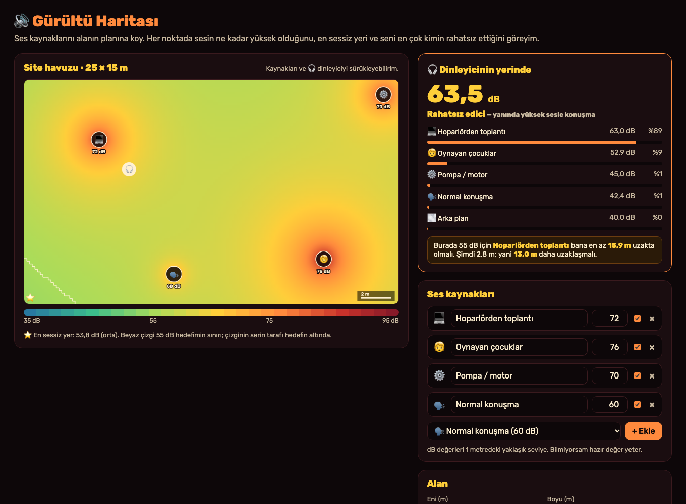
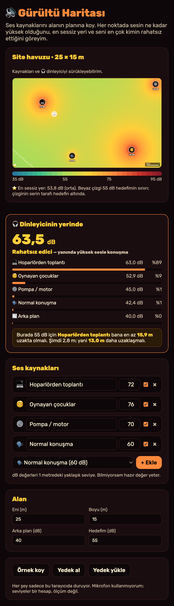

# Gürültü Haritası

Aklıma bu geldi: Bugün Reddit'te biri, komşusunun site havuzuna birkaç monitör kurup bütün gün yüksek sesle toplantı yaptığını yazmıştı. Ben de şunu merak ettim: Havuzun neresine oturursam bu sesten kurtulurum? Komşu ne kadar uzağa giderse rahatlarım? Ben bu aracı bunun için yaptım. Bir alanın planına ses kaynaklarını yerleştiriyorum. Araç her noktada sesin ne kadar yüksek olduğunu ısı haritası olarak çiziyor, **en sessiz yeri** buluyor ve oturduğum yerde **beni en çok kimin rahatsız ettiğini** gösteriyor. Bu iki resim, benim çalıştırdığım uygulamanın gerçek ekranları.

## Ben nasıl kullanıyorum?

1. Ben bu klasörde `python3 -m http.server 8000` çalıştırıyorum. Sonra `http://localhost:8000` açıyorum.
2. Ben **Alan** kısmına yerin enini ve boyunu, **arka plan** sesini (rüzgâr, uzaktaki trafik) ve **hedefimi** (ör. 55 dB) yazıyorum.
3. Ben **Ses kaynakları** listesine hazır kaynaklardan ekliyorum: normal konuşma, hoparlörden toplantı, oynayan çocuklar, müzik, pompa, klima. Her birinin 1 metredeki ses seviyesini değiştirebiliyorum. Bir kaynağı kutucukla kapatıp açabiliyorum.
4. Ben plandaki kaynakları ve 🎧 dinleyiciyi **sürüklüyorum**. Boş bir yere tıklayınca dinleyici oraya gidiyor.
5. Ben ısı haritasında sesin nerede yüksek (kırmızı), nerede düşük (yeşil-mavi) olduğunu görüyorum. **Beyaz çizgi** hedefimin sınırı. **⭐** en sessiz yer.
6. Ben **Dinleyicinin yerinde** kartında oradaki toplam sesi, her kaynağın payını ve bir öneri görüyorum: "Burada 55 dB için toplantı bana en az 15,9 m uzakta olmalı; 13 m daha uzaklaşmalı."
7. Ben **Yedek al** ile planımı JSON olarak indiriyorum, **Yedek yükle** ile geri alıyorum.

Ben "Örnek koy" ile hemen deneyebiliyorum. **Örnekteki kaynaklar ve yerleri uydurma.** Mikrofon kullanmıyorum; buradaki seviyeler bir **hesap**, ölçüm değil.

## Ben içeride ne yaptım?

**Uzaklıkla ses nasıl azalıyor?** Açık havada bir noktadan çıkan ses, her yöne yayılan bir küre gibi büyüyor. Kürenin yüzeyi uzaklığın karesiyle büyüdüğü için ses enerjisi de uzaklığın karesiyle azalıyor (**ters kare yasası**). Desibel cinsinden bu şöyle:

`seviye(r) = seviye(1 m) − 20 · log10(r)`

Yani uzaklık **iki katına** çıkınca ses yaklaşık **6 dB** düşüyor, **10 katına** çıkınca **20 dB** düşüyor.

**Desibeller toplanmaz!** İki kaynak 60 dB ise toplam 120 dB değil, **63 dB**. Desibel bir logaritma olduğu için önce enerjiye çevirip topluyorum, sonra yine desibele çeviriyorum:

`toplam = 10 · log10(10^(L1/10) + 10^(L2/10) + …)`

Bu yüzden on tane 60 dB'lik kaynak birlikte sadece 70 dB ediyor. 20 dB daha sessiz bir kaynak ise toplamı neredeyse hiç değiştirmiyor.

**Ne kadar uzaklaşmalı?** Hedefimi aşmamak için baskın kaynağın payına ne kadar yer kaldığını buluyorum: `10^(hedef/10) − 10^(diğerleri/10)`. Sonra ters kare yasasını tersine çevirip o payı veren uzaklığı hesaplıyorum. Diğer kaynaklar zaten hedefin üstündeyse "o sussa bile yetmez" diyorum.

**Isı haritası.** Alanı 140 × 84 kadar küçük kareye bölüp her karede toplam sesi hesaplıyorum ve rengini seçiyorum.

Ben `core.mjs` içinde hesapları, `app.mjs` içinde çizimi ve sürüklemeyi tuttum. Hiçbir sunucu, hesap ya da API anahtarı kullanmıyorum.

## Ben neyi sınadım?

Ben `node test.mjs` komutunu çalıştırdım. **44 kontrol** geçti.

- Uzaklık iki katına çıkınca ses **6,02 dB**, on katına çıkınca **20 dB** düştü.
- İki eşit kaynak **+3,01 dB**, on eşit kaynak **+10 dB** verdi. 70 dB ile 50 dB'nin toplamı **70,04 dB** çıktı; sessiz olan neredeyse fark etmedi.
- Bir noktada bütün kaynakların paylarının toplamı **%100** çıktı.
- Tek kaynaklı bir alanda en sessiz yer kaynağa en uzak köşe çıktı. İki uçta iki eşit kaynak varken en sessiz yer tam ortası çıktı.
- Örnekte dinleyicinin yerinde ses **63,5 dB**, bunun **%89'u** hoparlörden toplantıdan geliyor. Araç toplantının 15,9 m uzakta olması gerektiğini söyledi. Toplantıyı tam o uzaklığa taşıyınca seviye **tam 55,00 dB** çıktı.
- Hedef 45 dB olunca, diğer sesler zaten bunun üstünde olduğu için araç "toplantı sussa bile yetmez" dedi.

Ben uygulamayı tarayıcıda da açtım. Toplantıyı sürükleyip uzaklaştırınca dinleyicinin yerinde ses 63,5'ten **55,1 dB'e** indi. Boş yere tıklayınca dinleyici oraya gitti. Kaynak kapatma, ekleme, yanlış hedef değerinin kırmızı olması ve alan boyutunu değiştirme çalıştı. Telefon boyutunda (375 piksel) sayfa yana taşmadı.

Denerken iki şey düzelttim:
- İlk örneğimde çocukları çok gürültülü (82 dB) koymuştum. Bütün havuz 58 dB'in üstünde kalıyordu, hiçbir hedef tutmuyordu. Örneği daha gerçekçi yaptım.
- En sessiz yeri gösteren ⭐ köşedeyse ölçek çubuğunun altında kalıyordu. Ölçeği sağ alta aldım, yıldızı kenardan biraz içeri çizdim.

Benim sınırlarım var. Model açık alan için: duvarlar, yankı, rüzgâr, zemin ve engeller yok. Kapalı bir odada ses bu kadar hızlı azalmaz. Kaynakların dB değerleri yaklaşık; gerçek bir ses ölçerle ölçülmedi. Sesin ne kadar rahatsız ettiği sadece desibele değil, frekansına ve kişiye de bağlı.

## Ben bunları nereden öğrendim?

- Ters kare yasası ve desibel toplama: lise fiziği ve akustik ders kitaplarında anlatılan temel formüller.
- Günlük seslerin yaklaşık seviyeleri: işitme sağlığı üzerine yazılmış genel kaynaklardaki tipik değerler (konuşma ~60 dB, elektrik süpürgesi ~70 dB). 85 dB ve üstünün uzun süre işitmeye zarar verebileceği de bu kaynaklarda geçiyor.

## Ben bugünün kaynaklarına nasıl baktım?

Ben 7 Kasım 2026 saat 08.52 Türkiye vaktinde [GitHub Trending günlük listesine](https://github.com/trending?since=daily) baktım. Gördüğüm 18 repo arasında ilk sırada [zed-industries/zed](https://github.com/zed-industries/zed) vardı ve "bugün 306 yıldız" yazıyordu. Bu, bütün GitHub'ın kesin birincisi olduğu anlamına gelmez. Ben onların kodunu kopyalamadım.

Ben aynı anda [Trends24 dünya listesinde](https://trends24.in/) ilk sırada bir Japonca kampanya etiketi (`#auPAYがもらえる`) gördüm. Projeme zorla eklemedim. Bu liste üçüncü taraf bir anlık görünümdür; bütün günün kesin en çok konuşulan konusu demem.

Ben [Reddit r/popular Top/Today listesinde](https://www.reddit.com/r/popular/top/?t=day) ilk sırada r/MadeMeSmile'da bir tıp öğrencisinin cerrahi asistanlık mülakatıyla ilgili gönderisini gördüm. Aynı listede r/mildlyinfuriating'de ["My neighbor brings a multi-monitor setup to the community pool and takes loud conference calls all day."](https://www.reddit.com/r/mildlyinfuriating/comments/1xpnhay/my_neighbor_brings_a_multimonitor_setup_to_the/) gönderisi vardı. Benim fikrim buradan çıktı. Bu tek görünüm, bütün Reddit'in en çok konuşulan konusunu kanıtlamaz.

Ben bu projeyi MIT lisansı ile paylaşıyorum.
